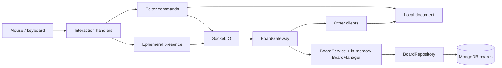

# Project overview

This is a collaborative canvas whiteboard. Users create or join a board by ID, draw and manipulate objects, and see other users' edits and temporary activity in real time. This document describes the current source tree (November 2026); start with the linked entry points when changing a feature. Generated `node_modules` and build output are excluded.

## At a glance

| Area | Purpose | Start here |
| --- | --- | --- |
| [frontend/](./frontend/) | React UI, canvas rendering, input handling, local document, undo/redo, Socket.IO client | [Whiteboard.tsx](./frontend/src/whiteboard/Whiteboard.tsx) |
| [backend/](./backend/) | NestJS Socket.IO gateway, board state, validation, MongoDB persistence | [board.gateway.ts](./backend/src/modules/board/board.gateway.ts), [BoardService.ts](./backend/src/modules/board/service/BoardService.ts) |
| [common/](./common/) | Shared TypeScript board-object shapes and editor/presence command types | [index.ts](./common/src/index.ts) |
| [docker-compose.yml](./docker-compose.yml) | Development frontend, backend and MongoDB containers | [README.MD](./README.MD) |

The root [package.json](./package.json) defines npm workspaces for **backend and common only**. The frontend has its own [package.json](./frontend/package.json) and lockfile. The frontend uses a TypeScript path alias to import directly from `common/src` ([tsconfig.app.json](./frontend/tsconfig.app.json)); the backend depends on the built `@whiteboard/common` package ([common/package.json](./common/package.json)).

**Stack:** TypeScript; React 19 and Vite 8 in the browser; NestJS 11, Socket.IO 4, Mongoose 9 and MongoDB on the server. The canvas uses the browser's 2D Canvas API. There is no client-side routing in the current app; [main.tsx](./frontend/src/main.tsx) mounts one whiteboard page.

## Main data flow

1. [BoardLobbyModal.tsx](./frontend/src/ui/lobby/BoardLobbyModal.tsx) collects a username and optionally a board ID. [SocketCollaboration.ts](./frontend/src/network/collaboration/SocketCollaboration.ts) sends `CREATE` or `JOIN`. The gateway returns `board-state`; [initializeBoard.ts](./frontend/src/whiteboard/initializeBoard.ts) loads objects/users, records the current user and clears local history.
2. [useWhiteboardInput.ts](./frontend/src/whiteboard/hooks/useWhiteboardInput.ts) connects pointer, wheel and keyboard events to [interaction/](./frontend/src/interaction/) handlers. The interaction state distinguishes drawing, moving, resizing, rotation, panning and selection. The [camera/](./frontend/src/camera/) converts screen and world coordinates.
3. Permanent edits go through [createEditor.ts](./frontend/src/editor/createEditor.ts): apply an `EditorCommand` to [createDocument.ts](./frontend/src/document/createDocument.ts), record an inverse for local undo/redo where supported, request a render, then send the command. Incoming peer commands use the same editor with broadcasting and history recording disabled. Undo/redo tracks per-object versions to avoid undoing a change after a peer modifies that object. Reorder commands currently have no inverse.
4. [board.gateway.ts](./backend/src/modules/board/board.gateway.ts) handles the socket event, calls [BoardService.ts](./backend/src/modules/board/service/BoardService.ts), and broadcasts the command to the board room excluding its sender. The service validates object creation/updates, mutates an in-memory [BoardManager.ts](./backend/src/managers/BoardManager.ts), and queues dirty changes. [BoardRepository.ts](./backend/src/modules/board/repository/BoardRepository.ts) periodically bulk-writes them to MongoDB.
5. Temporary cursor, selection, drag/create preview and laser activity goes through [SocketPresence.ts](./frontend/src/network/presence/SocketPresence.ts) and `boardPresenceCommand`. The gateway relays it to peers without persisting it. [Whiteboard.tsx](./frontend/src/whiteboard/Whiteboard.tsx) keeps remote presence separately from the board document and renders it as an overlay.

## Frontend map

| Directory | Responsibility |
| --- | --- |
| [whiteboard/](./frontend/src/whiteboard/) | Composes the page, lobby, tools, editor, collaboration and presence; schedules canvas redraws with `requestAnimationFrame`. |
| [document/](./frontend/src/document/) | Mutable refs for the local objects and board users; loads the initial snapshot. |
| [editor/](./frontend/src/editor/) | Applies permanent object commands, selected-object actions and local history. |
| [interaction/](./frontend/src/interaction/) | Tool state machine and mouse/keyboard operations, including drawing, panning, selection, moving, resizing, rotating and text editing. |
| [objects/](./frontend/src/objects/) | Per-shape creation, geometry, hit tests, rendering, preview and property helpers. [objectHandlers.ts](./frontend/src/objects/registry/objectHandlers.ts) registers handlers by object type; [createObject.ts](./frontend/src/objects/createObject.ts) uses that same registry to create drawable objects. |
| [rendering/](./frontend/src/rendering/) | Background/grid, objects, selection, remote cursors and laser cleanup. |
| [network/](./frontend/src/network/) | One Socket.IO connection, board/current-user state, durable collaboration messages and ephemeral presence messages. |
| [ui/](./frontend/src/ui/) | Lobby, toolbar, shape/drawing menus, object inspector, settings and remote cursor components. |

The available tools are pan, select, rectangle, circle, triangle, arrow, stroke, laser, textbox and text ([Tool.ts](./frontend/src/types/Tool.ts)). [Whiteboard.tsx](./frontend/src/whiteboard/Whiteboard.tsx) selects the rendering pipeline and keeps the canvas camera, local selection, remote presence and animation state. Shape-specific behavior belongs in the corresponding folder under [objects/](./frontend/src/objects/), with the registry connecting it to generic interaction code.

## Server map and storage

[main.ts](./backend/src/main.ts) starts Nest on port **3000**, enables CORS for `http://localhost:5173`, and installs a global validation pipe. [app.module.ts](./backend/src/app.module.ts) loads configuration and connects Mongoose using `DATABASE_URL`; it imports [board.module.ts](./backend/src/modules/board/board.module.ts). That module wires the gateway, service, repository, board schema and websocket rate/connection limit services.

The gateway is the active external API. [BoardController.ts](./backend/src/modules/board/controller/BoardController.ts) contains commented code; there is no active board HTTP controller. [chat.module.ts](./backend/src/modules/chat/chat.module.ts) is empty and is not imported by the app module; [chat.gateway.ts](./backend/src/modules/chat/chat.gateway.ts) is therefore outside the active board flow.

[BoardService.ts](./backend/src/modules/board/service/BoardService.ts) owns a map of live boards. Each [BoardManager.ts](./backend/src/managers/BoardManager.ts) contains an ordered object map, a user map and `lastActivity`. [ObjectManager.ts](./backend/src/managers/ObjectManager.ts) preserves object stacking order through map insertion order; moving an object to the front deletes and reinserts it. [UserManager.ts](./backend/src/managers/UserManager.ts) assigns users display colors.

MongoDB stores one [BoardSchema.ts](./backend/src/modules/board/schemas/BoardSchema.ts) document per board: custom `id`, `ownerId`, embedded `objects` and `users`, `version`, and `lastActivity`. The service first reads a board from memory, then falls back to MongoDB. It flushes dirty object/user/activity changes every 15 seconds and on application shutdown, removes idle empty boards from memory, and deletes expired boards from MongoDB based on `lastActivity`. [shapeValidators.ts](./backend/src/lib/util/shapeValidators.ts) dispatches creation and update validation to the individual validators in [validators/](./backend/src/lib/util/validators/). Laser is excluded from persistent validation because it travels as presence. The [BoardObjectSchema.ts](./backend/src/modules/board/schemas/BoardObjectSchema.ts) lists supported object fields, while the board schema stores objects as mixed embedded values.

## Socket contract

| Client event | Server action | Response/relay |
| --- | --- | --- |
| `boardCommand` | `CREATE`, `JOIN`, `LEAVE`, `GET`, `DELETE` board operations | `board-state` snapshot for create/join; `user-joined-board`, `user-left-board`, `get-board-response` where applicable |
| `boardObjectCommand` | Create, update, delete or bring object(s) to front | Same event broadcast to other sockets in board room after server processing |
| `boardPresenceCommand` | Relay a temporary command to board peers | Same event broadcast to other sockets in board room; no database write |

See [BoardCommandDTO.ts](./backend/src/modules/board/dto/BoardCommandDTO.ts), [EditorCommand.ts](./common/src/commands/EditorCommand.ts), [PresenceCommand.ts](./common/src/commands/PresenceCommand.ts) and [BoardStateDTO.ts](./frontend/src/network/collaboration/BoardStateDTO.ts) for payload shapes. The shared [BoardObject](./common/src/types/Object.ts) union covers rectangle, circle, triangle, arrow, stroke, laser, textbox and canvas text. [GlobalWsSocketExceptionFilter.ts](./backend/src/lib/errors/GlobalWsSocketExceptionFilter.ts) formats application websocket errors.

## Development and checks

The [README.MD](./README.MD) has step-by-step local and Docker instructions. In short, local development uses a MongoDB server on port 27017, the root npm workspaces for backend/common, and a separate frontend npm install. Override `DATABASE_URL` with a localhost MongoDB URL when running the backend directly: the checked-in [backend/.env](./backend/.env) uses the Docker hostname `mongo`. The Compose stack starts all three services and sets `DATABASE_URL` to `mongodb://mongo:27017/realtime-whiteboard` in [docker-compose.yml](./docker-compose.yml). The client connects to `http://localhost:3000` ([SocketClient.ts](./frontend/src/network/SocketClient.ts)); the frontend serves port 5173. The client URL and server CORS origin are currently hard-coded to localhost.

Build and lint commands are listed in the README. There is no configured root test script. The only checked-in test source is [chat.gateway.spec.ts](./backend/src/modules/chat/chat.gateway.spec.ts).

## Useful starting points for changes

- **Add a persistent shape:** define and export its type in [common/src/shapes/](./common/src/shapes/) and add it to [BoardObject](./common/src/types/Object.ts). Implement its frontend handler in [objects/](./frontend/src/objects/) and register it in [objectHandlers.ts](./frontend/src/objects/registry/objectHandlers.ts). Add a tool and menu entry if users should create it. Add create/update validators in [validators/](./backend/src/lib/util/validators/) and register both in [shapeValidators.ts](./backend/src/lib/util/shapeValidators.ts); update [BoardObjectDTO.ts](./backend/src/modules/board/dto/BoardObjectDTO.ts) if the shape introduces new fields.
- **Change an existing shape:** edit only the layers the change affects. A drawing change may stay in its frontend renderer. A data-field change also requires the shared type and server DTO/validators, and may need a decision about existing persisted boards.
- **Change an edit command:** start with [EditorCommand.ts](./common/src/commands/EditorCommand.ts), [createEditor.ts](./frontend/src/editor/createEditor.ts), and [board.gateway.ts](./backend/src/modules/board/board.gateway.ts); review persistence in [BoardService.ts](./backend/src/modules/board/service/BoardService.ts) and [BoardRepository.ts](./backend/src/modules/board/repository/BoardRepository.ts).
- **Change transient collaboration:** start with [PresenceCommand.ts](./common/src/commands/PresenceCommand.ts), [SocketPresence.ts](./frontend/src/network/presence/SocketPresence.ts), [Whiteboard.tsx](./frontend/src/whiteboard/Whiteboard.tsx) and the gateway.
- **Change input or canvas behavior:** start with [useWhiteboardInput.ts](./frontend/src/whiteboard/hooks/useWhiteboardInput.ts), [interaction/](./frontend/src/interaction/), [camera/](./frontend/src/camera/) and [rendering/](./frontend/src/rendering/).

The root [README.MD](./README.MD) provides setup steps and a brief product summary. The older [frontend/project-architecture.md](./frontend/project-architecture.md) contains paths that no longer match the current frontend tree; use this overview and the linked source for current navigation.
